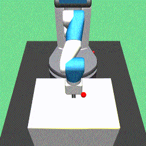
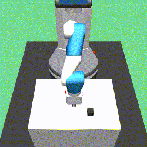
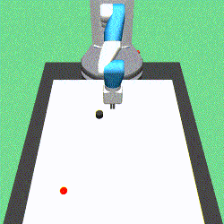

# HER + DDPG for Fetch Robot Manipulation

基于 **Hindsight Experience Replay (HER)** 与 **Deep Deterministic Policy Gradient (DDPG)** 的 Fetch 机器人操作任务训练框架。

支持三种 MuJoCo 场景配置（无障碍 / 双静态障碍 / 双动态障碍），并内置障碍物感知奖励、MPI 并行训练、W&B 实验跟踪与策略 GIF 生成。

---

## 特性

- **算法**：HER + DDPG，支持 `future` 目标替换策略
- **任务**：Gymnasium Robotics `FetchReach-v4`、`FetchPush-v4`、`FetchPickAndPlace-v4`、`FetchSlide-v4`
- **场景**：
  - `free` — 无障碍自由环境
  - `2Staticobs` — 双静态障碍物
  - `2Dynamicobs` — 双动态障碍物（正弦轨迹运动）
- **奖励扩展**：
  - 障碍物软惩罚（`obstacle-reward-weight`）
  - 碰撞惩罚（`collision-penalty`）
  - 稠密距离奖励（`dense-reward-weight`）
- **工程**：MPI 多进程并行采样、Running Mean/Std 归一化、GPU 自动分配
- **可视化**：训练曲线导出、策略执行 GIF 自动生成、W&B 在线跟踪

---

## 演示

| Reach | Push | PickAndPlace | Slide |
|:---:|:---:|:---:|:---:|
|  |  |  |  |

---

## 项目结构

```text
.
├── train.py                    # 训练入口
├── demo.py                     # 模型推理演示
├── test_env.py                 # 环境快速测试（生成 GIF）
├── arguments.py                # 命令行参数解析
├── env_utils.py                # XML 路径管理、环境 ID 工具
├── plot_results.py             # 从 W&B 导出训练曲线
├── plot_local_results.py       # 从本地 CSV 绘制训练曲线
├── tmux_train_all.sh           # 双 GPU 批量训练脚本（2Staticobs + 2Dynamicobs）
├── tmux_train_free.sh          # 双 GPU 批量训练脚本（free 环境）
├── her_modules/                # HER 采样器
├── rl_modules/                 # DDPG 网络、回放缓冲、奖励函数、动态障碍包装器
├── mpi_utils/                  # MPI 同步与归一化
├── xml_envs/                   # MuJoCo XML 场景定义
│   ├── free/
│   ├── 2Staticobs/
│   └── 2Dynamicobs/
└── docs/assets/                # README 演示素材
```

> **注意**：`figures/`、`saved_models/`、`wandb/`、`__pycache__/` 等运行时输出目录已被 `.gitignore` 排除，不会进入版本控制。

---

## 环境要求

- Python >= 3.10
- CUDA >= 11.8（如需 GPU 加速）
- OpenMPI（`mpi4py` 依赖）
- MuJoCo >= 3.0

---

## 安装

### 1. 克隆仓库

```bash
git clone https://github.com/heronx07/HER-DDPG-NCU.git
cd HER-DDPG-NCU
```

### 2. 创建虚拟环境（推荐 Conda）

```bash
conda create -n her python=3.10 -y
conda activate her
```

### 3. 安装 PyTorch（根据你的 CUDA 版本选择）

```bash
# CUDA 11.8 示例
pip install torch==2.1.0 torchvision==0.16.0 torchaudio==2.1.0 --index-url https://download.pytorch.org/whl/cu118
```

> 其他版本请参考 [PyTorch 官网](https://pytorch.org/get-started/locally/)。

### 4. 安装其余依赖

```bash
pip install -r requirements.txt
```

### 5. 安装 OpenMPI（系统级依赖）

```bash
# Ubuntu / Debian
sudo apt-get update && sudo apt-get install -y libopenmpi-dev

# 或使用 Conda
conda install -c conda-forge openmpi
```

### 6. （可选）配置 Weights & Biases

```bash
pip install wandb
wandb login
# 或在运行前设置环境变量：export WANDB_API_KEY="your_key"
```

---

## 快速开始

### 环境测试

不启动训练，仅测试 MuJoCo 环境渲染并生成测试 GIF：

```bash
python test_env.py \
  --env-name FetchPush-v4 \
  --env-config 2Staticobs \
  --steps 50
```

输出保存在 `test_gifs/2Staticobs/FetchPush-v4/`。

### 单任务训练

```bash
mpirun -np 4 python -u train.py \
  --env-name FetchPush-v4 \
  --env-config 2Staticobs \
  --n-epochs 200 \
  --n-cycles 50 \
  --n-batches 40 \
  --seed 123 \
  --obstacle-reward-weight 0.2 \
  --obstacle-safe-distance 0.10 \
  --collision-penalty 0.0 \
  --dense-reward-weight 0.0 \
  --cuda
```

参数说明：
- `--env-config`：选择场景 (`free` / `2Staticobs` / `2Dynamicobs`)
- `--obstacle-reward-weight`：障碍物软惩罚权重，设为 `0.0` 即恢复原始稀疏奖励
- `--collision-penalty`：碰撞硬惩罚权重
- `--dense-reward-weight`：稠密距离奖励权重
- `--n-epochs`：总训练轮数
- `--n-cycles`：每 epoch 采样轮数
- `--n-batches`：每 cycle 网络更新次数

### 批量训练（多 GPU）

项目中提供了 `tmux` 批量训练脚本，适合在服务器后台运行：

```bash
# 训练 free 环境（双 GPU 分别跑不同任务）
export WANDB_API_KEY="your_wandb_key"
bash tmux_train_free.sh

# 同时训练 2Staticobs + 2Dynamicobs
bash tmux_train_all.sh
```

训练将在后台 `tmux` session 中运行：
- `tmux attach -t her_training` 查看进度
- `Ctrl+B, d` 脱离 session（训练继续）

### 模型评估

```bash
python demo.py \
  --env-name FetchPush-v4 \
  --env-config 2Staticobs \
  --seed 123 \
  --demo-length 20
```

默认加载 `saved_models/FetchPush-v4/FetchPush-v4-2staticobs-ddpg-123/model.pt`。

---

## 三种场景配置对比

| 配置 | 描述 | 适用场景 |
|:---|:---|:---|
| `free` | 标准 Fetch 环境，无任何障碍物 | 基线对比、快速验证 |
| `2Staticobs` | 场景中放置两个静态盒子障碍物 | 静态避障、路径规划 |
| `2Dynamicobs` | 两个障碍物按正弦轨迹运动 | 动态避障、时序决策 |

动态障碍物的运动由 `rl_modules/dynamic_obs_wrapper.py` 控制，默认在 `step()` 中更新障碍物位置，并将障碍物状态（位置+速度，12维）拼接到 observation 中。

---

## 核心超参数速查

| 参数 | 默认值 | 说明 |
|:---|:---|:---|
| `--n-epochs` | 50 | 总训练 epoch 数 |
| `--n-cycles` | 50 | 每 epoch 采样 cycle 数 |
| `--n-batches` | 40 | 每 cycle 更新次数 |
| `--batch-size` | 256 | 训练批次大小 |
| `--buffer-size` | 1e6 | 经验回放缓冲区容量 |
| `--lr-actor` / `--lr-critic` | 0.001 | Actor / Critic 学习率 |
| `--gamma` | 0.98 | 折扣因子 |
| `--polyak` | 0.95 | Target 网络软更新系数 |
| `--noise-eps` | 0.2 | 高斯动作噪声幅度 |
| `--random-eps` | 0.3 | 随机动作探索概率 |
| `--replay-k` | 4 | HER 替换比例参数 |
| `--clip-obs` | 200 | Observation 裁剪范围 |
| `--num-rollouts-per-mpi` | 2 | 每个 MPI 进程每 cycle 的 episode 数 |

---

## 结果可视化

### 从 W&B 导出（需联网）

```bash
python plot_results.py \
  --entity your-wandb-entity \
  --project her \
  --env-config all
```

### 从本地 CSV 绘制（无需 W&B）

训练过程中会自动在 `saved_models/` 下生成 `metrics.csv`，可用以下命令直接绘图：

```bash
python plot_local_results.py \
  --save-dir saved_models \
  --env-config 2Staticobs \
  --output-dir figures/local_plots
```

---

## 自定义开发

如果你想修改奖励函数、网络结构或 HER 策略，请参考项目内的 [`her_guide.md`](her_guide.md)。该文档包含：

- 各模块的详细职责与数据流
- 常见修改场景的 Prompt 模板
- 文件依赖关系图

---

## 引用

本项目参考了以下工作：

- **HER**: Andrychowicz et al., "Hindsight Experience Replay", NeurIPS 2017
- **DDPG**: Lillicrap et al., "Continuous Control with Deep Reinforcement Learning", ICLR 2016
- **OpenAI Baselines HER**: [openai/baselines](https://github.com/openai/baselines)
- **Gymnasium Robotics**: [Farama-Foundation/Gymnasium-Robotics](https://github.com/Farama-Foundation/Gymnasium-Robotics)

---

## License

本项目采用 [MIT License](LICENSE)。
